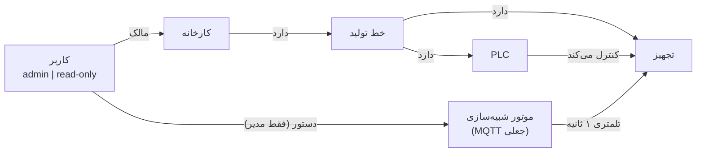

# کارخانه هوشمند — Smart Factory Demo

نمونه اولیه (prototype) فرانت‌اند برای پایش و کنترل خطوط تولید یک کارخانه هوشمند.
این نسخه فقط فرانت‌اند است و هیچ بک‌اند، دیتابیس یا MQTT واقعی ندارد؛ تمام داده‌ها
و رفتار PLC‌ها با یک موتور شبیه‌سازی درون‌مرورگری تولید می‌شوند.

## اجرا

```sh
npm install
npm run dev
```

سپس `http://localhost:5173` را باز کنید.

## حساب‌های نمونه

| نام کاربری | رمز عبور    | نقش        | دسترسی                                    |
| ---------- | ----------- | ---------- | ----------------------------------------- |
| `admin`    | `admin123`  | مدیر       | پایش + ارسال دستور به تجهیزات             |
| `viewer`   | `viewer123` | فقط مشاهده | فقط پایش؛ کنترل‌ها غیرفعال نمایش داده می‌شوند |

در صفحه ورود، کارت هر نقش با یک کلیک فرم را پر می‌کند. پس از ورود هم می‌توانید از
منوی پایین سایدبار نقش را تغییر دهید تا تفاوت دسترسی را در دمو نشان دهید.

## قابلیت‌ها

- **داشبورد کارخانه‌ها** — شاخص‌های کلی، وضعیت هر خط و آخرین دستورات.
- **صفحه کارخانه** — فهرست خطوط تولید هر کارخانه با وضعیت لحظه‌ای.
- **نقشه شماتیک خط تولید** — تجهیزات روی یک دیاگرام صنعتی با لوله‌های متحرک،
  وضعیت رنگ‌بندی‌شده و مقدار لحظه‌ای هر تجهیز.
- **پنل کنترل تجهیز** — با کلیک روی هر تجهیز، یک Sheet باز می‌شود که مقدار لحظه‌ای،
  نمودار روند ۶۰ ثانیه، کنترل‌های مخصوص همان نوع تجهیز و تاریخچه دستورات را نشان می‌دهد.
- **شبیه‌سازی قطعی PLC** — با دکمه «قطع ارتباط» روی هر PLC، تجهیزات آن آفلاین شده و
  ارسال دستور برایشان قفل می‌شود.
- **تلمتری هر ۱ ثانیه** — همه مقادیر با یک تیک یک‌ثانیه‌ای به‌روزرسانی می‌شوند.
- **زمان‌بندی دستورات** — اجرای خودکار دستور روی تجهیزات: یک‌بار، روزانه یا هفتگی
  (با انتخاب روزهای هفته). هر تجهیز بخش «زمان‌بندی‌های تجهیز» در پنل خود دارد و
  صفحه «زمان‌بندی‌ها» همه آن‌ها را با شمارش معکوس زنده نشان می‌دهد.

## مدل دامنه



انواع تجهیزات: موتور، پمپ، شیر، کوره/هیتر، روشنایی، نوار نقاله و سنسور
(دما، فشار، سطح، دبی، لرزش).

## ساختار پروژه

```
src/
  components/
    ui/            کامپوننت‌های shadcn/ui
    common/        کامپوننت‌های مشترک (پوسته اپ، نشان وضعیت، ...)
    dashboard/     کارت کارخانه، شاخص‌ها، فید رویدادها
    factory/       شبکه خطوط تولید
    line/          نقشه شماتیک، ریل PLC، پنل تجهیز و کنترل‌ها
  pages/           صفحه‌های ورود، داشبورد، کارخانه، خط تولید
  hooks/           هوک‌های تلمتری، دستور و احراز هویت
  services/mock/   داده‌های اولیه، موتور شبیه‌سازی، سرویس دستور
  store/           استورهای Zustand (auth، telemetry، commands)
  dto/             تایپ‌های دامنه
  utils/           فرمت اعداد فارسی، وضعیت تجهیزات، i18n و ...
public/locales/fa/translation.json   همه رشته‌های فارسی
```

## اسکریپت‌ها

| دستور                | کار                      |
| -------------------- | ------------------------ |
| `npm run dev`        | اجرای محیط توسعه         |
| `npm run build`      | بیلد تایپ‌چک‌شده         |
| `npm run lint`       | اجرای oxlint             |
| `npm run format`     | فرمت با Prettier         |
| `npm test`           | تست منطق زمان‌بندی        |

## تکنولوژی

React 19 · TypeScript (strict) · Vite · Tailwind CSS v4 · shadcn/ui ·
Zustand · TanStack Query · React Router · i18next · sonner · lucide-react
